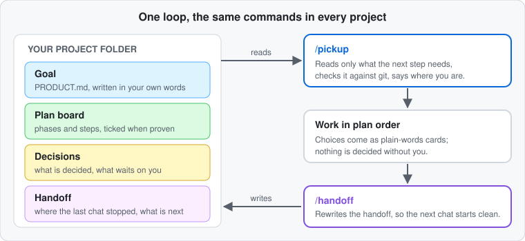

# Project Workflow for Claude Code

A way of working that keeps Claude on track from one chat to the next. Every project gets a goal in your own words, a plan board with ticks, a decisions log, and a handoff note. New chats pick up exactly where the last one stopped, read only the files they need, and ask you questions as plain-words choice cards instead of jargon.

You keep the same short commands in every project: `/pickup`, `/handoff`, `/plan`, `/new-project`, `/project-audit`, `/project-sync`.



## What you need
- [Claude Code](https://claude.com/claude-code) (terminal, desktop app or IDE).
- [Node.js](https://nodejs.org) 18 or newer (the helper scripts and the installer are Node). Check with `node --version`.
- git is optional but recommended (projects are tracked in git; `/pickup` compares the handoff with git).

## Install (3 steps)
1. Download this repository (green **Code** button, then **Download ZIP**, or `git clone https://github.com/ZivacHub/Project-Workflow.git`) and open a terminal in that folder.
2. Run `node install.mjs`. It asks two things: **which folder holds your projects** (it is created if missing) and **what name Claude should call you**. It shows what it will do and waits for your "y".
3. Open Claude Code inside any project folder under that folder and type `/pickup` (continue a project) or, in an empty folder, `/new-project`. Open a chat in your projects folder itself to see the overview of all projects.

Try it without risk first: `node install.mjs --dry-run` prints everything it would do and writes nothing.

## What the installer changes on your computer
Everything is inside your Claude folder (`~/.claude`) and your projects folder. Nothing else.
| What | Where |
|---|---|
| Skills (`pickup`, `handoff`, `plan`, `new-project`, `project-audit`, `project-sync`, `prior-art`, `info`, `delegate`, `overview`, `update-workflow`) | `~/.claude/skills/<name>/` |
| Helper scripts and the start-up check | `~/.claude/hooks/` |
| One start-up entry that runs the check when a chat opens | `~/.claude/settings.json` (your other settings stay) |
| A clearly marked block of working rules | `~/.claude/CLAUDE.md` (your own text stays; the block sits between `PROJECT-WORKFLOW:BEGIN` and `END`) |
| Your name and options | `~/.claude/project-workflow-config.json` |
| A record of what it installed (so it can update and undo) | `~/.claude/project-workflow-install.json` |
| The project template and a short README | `<your projects folder>/_template/`, `README.md` |
| A copy of every file it replaced | `~/.claude/project-workflow-backup/<time>/` |

It never replaces a file you edited, and it stops (without changing anything) if a file with the same name exists that it did not install. `--force` replaces it after making a backup.

## Everyday use
| You type | What happens |
|---|---|
| `/new-project` | A long interview, a search for similar projects, one-by-one choices, then a phased plan. Nothing is built until you approve the plan. Also for a project that already exists: it reads the code first, skips what the files already answer and plans only what remains. |
| `/info` | Lists these commands and how to use each one, in any chat. |
| `/overview` | Where are we? A short plain summary plus a picture page: the phases in a row, the step you are on highlighted, decisions waiting, last handoff, git state. From the projects folder it shows every project. Changes nothing. |
| `/delegate` | Before every task Claude gives it a difficulty grade (light / standard / strong) and says it out loud. Light and standard tasks run in helpers on a cheaper model and effort, hard ones stay in your chat, and each result is checked before the step is ticked. It happens by itself. |
| `/pickup` or "continue" | Loads the goal, plan board, open decisions and handoff, checks them against git, tells you in plain words where you are, continues in plan order. |
| `/handoff` or "wrap up" | Rewrites the handoff note from scratch so the next chat starts cleanly. |
| `/plan` | Shows progress, changes the plan (with your OK), runs the check before and after each phase. |
| `/project-audit` | Audits an existing project that has code, writes findings with fix prompts. |
| `/project-sync` | Brings older projects up to the current template, one at a time, asking first. |
| `node ~/.claude/hooks/project-workflow-status.mjs` | One table: every project, plan progress, decisions waiting, handoff age. |

A project looks like this (see `examples/my-first-project` for a filled-in one):
```
my-project/
  CLAUDE.md  README.md  (your code)
  docs/INDEX.md  PRODUCT.md  DECISIONS.md
  docs/plan/BOARD.md  docs/plan/phases/01-first-phase.md
  docs/reference/   (design, architecture, testing ... read only when needed)
  .claude/handoff.md  .claude/memory.md
```
Pickups stay small on purpose: they read only the goal, the board, open decisions, the handoff, and the few files the handoff names.

## Options
`~/.claude/project-workflow-config.json`:
| Key | Meaning | Default |
|---|---|---|
| `root` | Your projects folder | asked at install |
| `owner` | The name Claude uses for you | asked at install |
| `remoteControl` | `/pickup` switches Claude Code's Remote Control on, `/handoff` off when you end a chat | `false` |
| `renameChat` | `/pickup` renames the chat to "Project - next step - time" | `false` |
| `updateCheck` | Look once a day for a newer version (see Updates) | on |

## Updates
Once a day (at most), when a chat opens, the start-up check reads one small file (`VERSION`) from this repository on GitHub. If a newer version exists, Claude mentions it once; you say "update workflow" and Claude shows what changed and updates only after you agree. Nothing about you or your projects is sent; it is a plain download of one public file, skipped silently when you are offline. Turn it off with `"updateCheck": false`.
Manual update: download the newer repository and run `node install.mjs update` (add `--dry-run` to preview). Files you edited are kept; replaced files are backed up.

## Check and undo
- `node install.mjs check` tells you what is installed, what is missing and how to fix it.
- `node install.mjs uninstall` removes everything it installed, restores your `settings.json` and `CLAUDE.md`, and leaves your projects and the backups alone.

## Good to know
- Chats that are already open keep the old rules; new chats pick up changes.
- The scripts only read and write files inside your projects; they never send anything anywhere (apart from the one daily version check above).
- If `settings.json` is not valid JSON the installer refuses to touch it and tells you.

## Licence
MIT, see `LICENSE`. Contributions and bug reports are welcome as issues.
